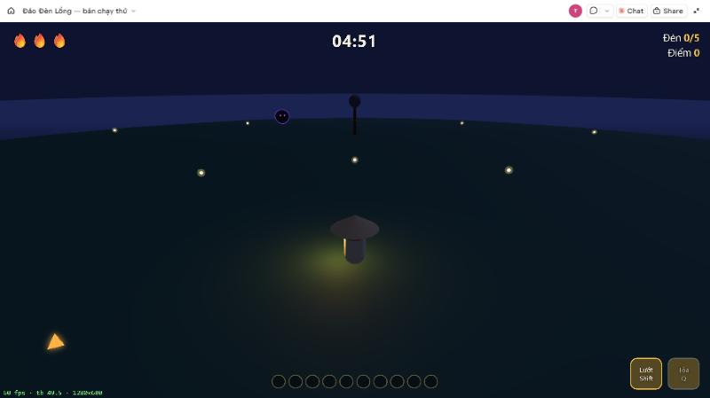

# Đảo Đèn Lồng — v1.0.0 (Day 12 AI SDLC · Nguyễn Công Tình · 2A202603373)

> **Video demo:** _xem Release [v1.0.0](../../releases/tag/v1.0.0) (đính kèm `demo.mp4`)_ · Tài liệu đề bài: [`docs/lab/`](docs/lab/README.md)



Game 3D góc nhìn thứ ba: Mây — người giữ đèn nhỏ tuổi đội nón lá — gom đom đóm thắp và **giữ** các Đèn Lồng Lớn sáng tới bình minh qua **3 Đêm** (Đảo Bến, Đảo Cau, Đảo Chuông), xua Bóng Mực hút dầu, coi chừng Gió Lạc. Có chế độ **headless** theo **Test Contract v1.3** (`game.contract.json`), benchmark, soak test và bảng xếp hạng cục bộ.

## Yêu cầu hệ thống
- **Node.js ≥ 22.18** (chạy TypeScript trực tiếp, **không cần `npm install`**, không có dependency).
- Trình duyệt hỗ trợ WebGL2 (Chrome/Edge/Firefox mới). Benchmark cần **Chrome, Chromium hoặc Edge** (tự dò; hoặc đặt `CHROME_PATH`).
- Internet khi chơi bản có giao diện để tải Three.js r170 từ CDN — trừ khi đã có `web/vendor/three.module.js` (xem dưới). Headless/soak/test không cần mạng, cửa sổ hay GPU.
- macOS / Linux / Windows.

## Cài đặt và chạy (3 lệnh)
```bash
git clone <repo> && cd <repo>
npm run build        # kiểm tra Node + xuất bản web tĩnh dist/web
npm start            # mở http://localhost:5173
```
Chơi offline: `curl -L -o web/vendor/three.module.js https://cdn.jsdelivr.net/npm/three@0.170.0/build/three.module.js` rồi `npm run build`.

## Điều khiển (đổi được trong Cài đặt → Phím)
| Mặc định | Hành động |
|---|---|
| W / A / S / D (và ↑/↓) | Đi theo hướng camera |
| Kéo chuột trái hoặc J / L | Xoay camera |
| Space | Nhảy |
| Shift trái | Lướt |
| E | Tương tác: nạp ánh sáng / thắp lại / châm dầu |
| Q | Tỏa Sáng |
| Esc (hoặc P) | Tạm dừng |

Luồng: Menu → giới thiệu Đêm (lời Ông Đăng) → chơi → kết quả → Đêm kế; thắng Đêm 3 → Bình Minh. Sau Bình Minh hoặc khi thua: nhập tên lưu điểm. Menu có **Bảng xếp hạng** và **Cài đặt** (âm lượng, độ nhạy chuột, bảng màu dễ phân biệt, giảm chuyển động, chữ lớn ×1.25, đổi phím có báo trùng + Khôi phục mặc định — tất cả được lưu).
Tham số URL (`?` hoặc `#`): `seed=123`, `night=2`, `fps`, `bench`.

## Luật & điểm (Contract v1.2–v1.3)
Luật: [`assumptions-phase2.md`](docs/notes/assumptions-phase2.md) + [ADR-0001](docs/adr/0001-den-can-dau-luat-thang.md). Tóm tắt: đèn sáng hao 1 dầu/giây và tắt khi cạn; châm dầu bằng đom đóm; Bóng Mực hút dầu đèn yếu (< 30); **thắng khi còn sống lúc bình minh với ≥ 60 % số đèn đang sáng** (3/5, 4/6, 5/7). Điểm: +5/đom đóm nạp, +100 thắp lần đầu, +40 thắp lại, +5 (+15 nếu đang hút) mỗi Bóng Mực trúng Tỏa Sáng; bình minh khi thắng: +50 + floor(fuel) mỗi đèn sáng, +50 mỗi Ngọn Lửa. Tổng điểm = tổng các Đêm đã thắng.

## Kiểm thử, headless, bench, soak
```bash
npm test                                   # 11 unit + 73 scenario headless (kỳ vọng tính tay), ~45 s
node src/headless/cli.ts --seed 1 --night 1 --ticks 600 --out out/run.jsonl [--scenario s.json] [--inputs i.json]
node tools/bench.ts --seed 42 --duration 30 --out bench.json      # bench_cmd: mở Chrome 1280×720, vsync tắt bằng cờ
node --expose-gc --no-opt --no-maglev tools/soak.ts --seed 7 --nights 10 --out soak.json   # soak_cmd
node tools/serve.ts --export-leaderboard out.json                  # xuất bảng xếp hạng {"entries": [...]}
PHASE=phase-4 npm run verify               # test + tất định + schema + tốc độ + soak → docs/proof/phase-4/
```
- **Bench:** cảnh chuẩn Ticket-04 (200 Bóng Mực wander, 100 đom đóm, L1–L3 sáng, camera bay vòng 30 m / Y 15 / 15 s). vsync tắt bằng `--disable-gpu-vsync --disable-frame-rate-limit`. `peak_mem_mb` = tổng RSS các tiến trình trình duyệt của phiên bench (đọc bằng `ps`; trên Windows ghi `null`). Mở trực tiếp trang với `#bench` cũng chạy được cảnh và hiện kết quả.
- **Soak:** cờ `--no-opt --no-maglev` tắt JIT tối ưu để RSS phản ánh bộ nhớ của game (heap đứng yên ~8 MB qua 30 Đêm) — xem [`docs/proof/phase-4/README.md`](docs/proof/phase-4/README.md).
- **Bảng xếp hạng** lưu ở `data/leaderboard.json` (đổi bằng biến `DDL_LEADERBOARD`); bản web tĩnh không có server thì lưu localStorage.

## Bằng chứng & tài liệu
Truy vết từng phase: [P1](docs/proof/phase-1/traceability.md) · [P2](docs/proof/phase-2/traceability.md) · [P3](docs/proof/phase-3/traceability.md) · [P4](docs/proof/phase-4/traceability.md). [CHANGELOG](CHANGELOG.md) · [CREDITS](CREDITS.md) · [Retro](docs/notes/retro.md) · [Nhật ký AI](docs/notes/ai-log.md). CI chạy build + test + verify trên Ubuntu/macOS, Node 22/24.

## Harness AI
`AGENTS.md` (+ `CLAUDE.md`), hook Stop chặn kết thúc khi `npm test` đỏ (`.claude/settings.json`), skill `.claude/skills/verify`, CI `.github/workflows/ci.yml`.

## Sáng tạo của tôi
- Vòng sáng vùng an toàn quanh đèn, thanh dầu, sóng Tỏa Sáng, bầu trời ấm dần theo tiến độ; lời dẫn của Ông Đăng mỗi Đêm.
- Âm thanh tổng hợp hoàn toàn bằng WebAudio (không file asset).
- Bot tự chơi (`tools/bot.ts`) dùng chính core để sinh inputs phát lại qua headless; dải báo lỗi JS ngay trên trang.
- Tên bảng xếp hạng hỗ trợ tiếng Việt có dấu.
- Các phần này chỉ ở lớp hiển thị/công cụ, **không đổi output headless** (73 scenario + tất định vẫn đạt; tắt trong cảnh bench vì cảnh bench tự dựng).

## Cấu trúc
`src/core` (luật, tất định, không DOM) · `src/headless` (CLI) · `src/render` (Three.js, âm thanh) · `web/` · `tools/` (server, serve, build, bench, soak, verify, bot) · `tests/` · `docs/` (adr, notes, proof, lab).
